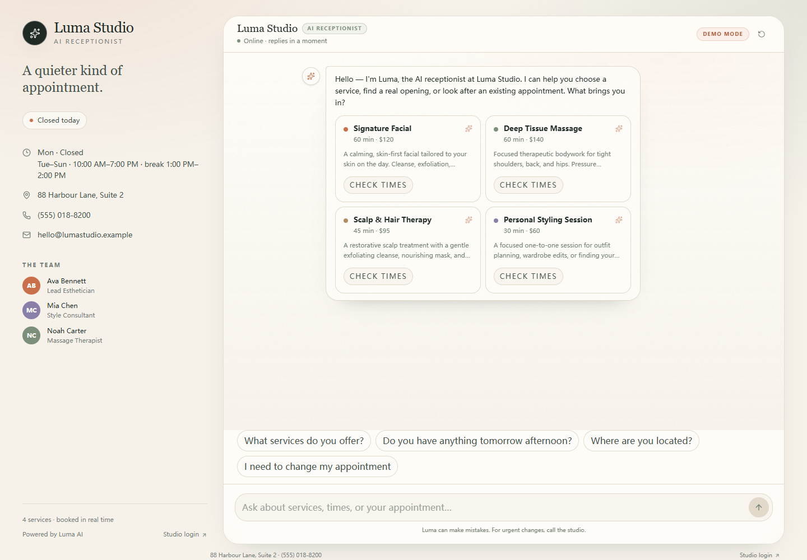

# Luma Studio — AI Receptionist

An English, responsive AI receptionist for a multi-service studio. Customers can ask about services, see real availability, book, reschedule, and cancel. The studio gets an admin dashboard and optional Google Calendar sync.



## What it does

- **Answers questions** about services, prices, hours, address, parking, payment, cancellation policy, and first visits.
- **Checks real availability** from opening hours, service duration, buffers, existing bookings, staff schedules, and busy Google Calendar events.
- **Books in two phases** — a draft is prepared, the customer confirms, then the appointment is written. The AI cannot invent a slot or confirm without an explicit yes.
- **Manages appointments** — lookup by phone and booking code, reschedule, and cancel. Changes inside the cancellation window are handed to a person.
- **Works without an API key** — a deterministic English fallback bot handles the same booking flow.
- **Syncs to Google Calendar** when configured, with one unified studio calendar.
- **Admin dashboard** — appointments, services, team, knowledge base, conversations, and settings.

## Stack

- Next.js 16 (App Router, Node runtime)
- React 19, TypeScript, Tailwind CSS 4
- SQLite through Node's built-in `node:sqlite` (`data/app.db`)
- Pluggable OpenAI-compatible models: DeepSeek, Groq, or a custom endpoint
- Google Calendar API through `googleapis`
- `chrono-node` for natural-language dates, `date-fns-tz` for time zones
- Vitest for domain and booking tests

## Quick start

Requirements: Node.js 20.9+ (tested with Node 24.21), npm.

```powershell
Copy-Item .env.example .env.local
# Edit .env.local: set ADMIN_PASSWORD and SESSION_SECRET
npm install
npm run dev
```

Open:

- Customer chat: <http://localhost:3000>
- Studio dashboard: <http://localhost:3000/admin>

The first run creates `data/app.db` and seeds the Luma Studio demo data (4 services, 3 team members, FAQs, and three example bookings). Set `SEED_DEMO=false` if you want an empty studio.

The local `.env.local` contains a demo admin password. Change it before sharing the app.

## Configuration

| Variable | Purpose |
|---|---|
| `APP_URL` | Public URL used for OAuth redirects and links |
| `BUSINESS_TIMEZONE` | Store time zone, default `Etc/GMT+4` (UTC-4) |
| `AI_PROVIDER` | `deepseek` (default), `groq`, or `openai-compatible` |
| `AI_MODE` | `auto`, `live`, or `fallback` |
| `AI_TIMEOUT_MS` | Model request timeout, clamped to 1–60 seconds |
| `DEEPSEEK_API_KEY` / `DEEPSEEK_BASE_URL` / `DEEPSEEK_MODEL` | DeepSeek connection |
| `GROQ_API_KEY` / `GROQ_BASE_URL` / `GROQ_MODEL` | Groq connection; default model `openai/gpt-oss-120b` |
| `OPENAI_COMPATIBLE_API_KEY` / `OPENAI_COMPATIBLE_BASE_URL` / `OPENAI_COMPATIBLE_MODEL` | Generic OpenAI-compatible connection |
| `GOOGLE_CLIENT_ID` / `GOOGLE_CLIENT_SECRET` | Google OAuth web client |
| `GOOGLE_REDIRECT_URI` | Default `http://localhost:3000/api/google/callback` |
| `GOOGLE_CALENDAR_ID` | Default `primary`; can also be changed in Settings |
| `ADMIN_PASSWORD` | Studio dashboard password |
| `SESSION_SECRET` | Random value used to sign the admin cookie |
| `SEED_DEMO` | `true` to seed the demo studio on first run |

### AI provider

Set `AI_PROVIDER` to one of `deepseek`, `groq`, or `openai-compatible`, fill that provider's variables, then restart. The app never falls back to another provider's key.

**DeepSeek (default):**

```env
AI_PROVIDER=deepseek
DEEPSEEK_API_KEY=sk-...
DEEPSEEK_BASE_URL=https://api.deepseek.com
DEEPSEEK_MODEL=deepseek-flash
```

**Groq:**

```env
AI_PROVIDER=groq
GROQ_API_KEY=gsk_...
GROQ_BASE_URL=https://api.groq.com/openai/v1
GROQ_MODEL=openai/gpt-oss-120b
```

`openai/gpt-oss-120b` is an open-weight reasoning model served by Groq, not GPT-6. Tool calling must be available for the model and account. The adapter sends `max_completion_tokens`, disables parallel tool calls, and uses `reasoning_effort: "low"` for GPT-OSS. Verify the model in your Groq account before relying on it.

**Custom OpenAI-compatible endpoint:**

```env
AI_PROVIDER=openai-compatible
OPENAI_COMPATIBLE_API_KEY=...
OPENAI_COMPATIBLE_BASE_URL=https://provider.example/v1
OPENAI_COMPATIBLE_MODEL=provider/model-name
```

The base URL must be HTTPS (loopback HTTP is allowed for tests) and must not include `/chat/completions`. The endpoint must support OpenAI-style tools, `tool_calls`, and `tool` messages.

After restarting, open **Admin → Settings → AI model** to confirm the provider, model, and `live`/`fallback` state. If the selected provider is unavailable, the deterministic bot answers and the chat reports degraded mode. See [docs/ai-provider-setup.md](docs/ai-provider-setup.md) for the full compatibility and troubleshooting guide.

### Google Calendar

Google credentials are optional. Without them the app runs in local scheduling mode. When you are ready, follow [docs/google-calendar-setup.md](docs/google-calendar-setup.md) or open <http://localhost:3000/docs/google-calendar-setup>.

After connecting, new confirmed appointments are written to the calendar. Existing local-only bookings can be pushed with **Backfill** in the dashboard. The calendar connection is managed from **Settings**.

## Demo conversation

1. **What services do you offer?**
2. **Do you have anything tomorrow afternoon?**
3. Choose **Signature Facial**.
4. **Tomorrow at 3 PM** (or another date/time).
5. Pick an offered slot, enter a name and a 10–15 digit phone number.
6. Review the draft and click **Confirm booking**.
7. The confirmation card shows `LUMA-XXXXXX` and an **Add to calendar** link.
8. Sign in to `/admin` and open **Appointments**.

Try **I need to change my appointment** or **Cancel my appointment** to see the code-and-phone flow.

## Scheduling rules

- Availability is generated from the store's opening hours, the service duration, the service buffer, and existing confirmed appointments.
- A 10-minute buffer blocks back-to-back starts that would overlap cleanup.
- The default lead time is 2 hours; bookings can be made up to 60 days ahead.
- One unified Google Calendar is supported. Events created by this app are tagged and skipped when staff-specific availability is calculated; external events block all staff conservatively.
- Changes inside the 24-hour cancellation window are handed to the studio instead of being automated.
- There is no temporary hold. Confirmation re-checks the slot and uses a SQLite transaction plus a unique index to prevent double booking.

## Admin

- **Overview** — today, next 7 days, handoffs, Google status, upcoming appointments.
- **Appointments** — search, filter, cancel, and retry Google sync.
- **Services & Team** — service duration, buffer, price, assignments, and team profiles.
- **Knowledge Base** — the FAQs Luma is allowed to answer from.
- **Conversations** — transcripts and handoff markers.
- **Settings** — business profile, hours, scheduling rules, time zone, and Google Calendar.

Admin APIs require an HttpOnly signed cookie. Login is rate-limited to 5 attempts per minute.

## Scripts

```bash
npm run dev        # local dev server on :3000
npm run build      # production build
npm start          # production server on :3000
npm test           # Vitest domain, booking, and tool tests
npm run typecheck  # TypeScript
npm run check      # typecheck + test
npm run smoke      # HTTP smoke test against a running server
npm run db:reset   # delete data/app.db and reseed on next start
```

## Project layout

```text
app/                 Next.js pages and API routes
components/chat/     customer chat UI and rich cards
components/admin/    studio dashboard
lib/ai/              model provider, tools, prompt, fallback bot
lib/calendar/        local and Google providers, OAuth
lib/data/            SQLite queries and admin CRUD
lib/db/              schema, connection, seed data
lib/domain/          dates, availability, booking lifecycle, ICS
tests/               Vitest suites
docs/                setup guides
data/                runtime SQLite database (gitignored)
```

## Security and privacy

- API keys and Google tokens stay server-side. `data/` and `.env.local` are gitignored.
- The Google token is stored at `data/google-token.json`; treat it as a password.
- Customer phone numbers are shown only in the admin dashboard and are not written into `.ics` files.
- All inputs are validated; SQL is parameterized; chat is rate-limited.
- The admin cookie is HttpOnly, SameSite=Lax, and Secure in production HTTPS.
- The app does not collect payment card details.

## Limitations

- Single studio, single app instance. In-process slot locks do not protect multiple server processes.
- No SMS or email notifications. Confirmation is in-chat plus an `.ics` download.
- One unified Google Calendar. External events block all staff (conservative).
- Google OAuth in Testing mode may require reconnecting about every 7 days.
- The AI chat is non-streaming; it shows a typing indicator while tools run.
- Groq/custom model compatibility depends on the provider and model supporting OpenAI-style tool calls. The app does not silently switch models.
- No online payments, deposits, waitlists, recurring appointments, or per-staff Google calendars.

## License

Internal demo project. Add a license before distributing.
